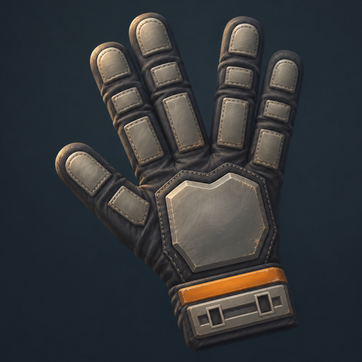

# Vulkan Exit Crash Fix



*live long then exit*

If you play Satisfactory with the **Vulkan** graphics API, the game crashes every single time you quit: you click
**Exit Game** or **Quit to Desktop**, and instead of closing, the Unreal crash reporter pops up. This mod makes the
game close cleanly instead.

### AI Disclosure
Let's get this out of the way. I used AI to diagnose the initial problem, set up the modding environment, and add the roughly 50 lines of code it takes to work around this problem. I don't write game code but I'm a software engineer by trade, and I take my stamp of approval seriously. I vetted the code myself and I tested it thoroughly.

### Do I need this?
Only if you run the game on Vulkan, i.e. **Options → Video → Graphics API** is set to Vulkan, or you launch with
`-vulkan`. On DirectX 11 or DirectX 12 the mod does nothing at all, so it's harmless to keep installed if you switch
back and forth.

### Is it safe?
- **Your save is never touched.** The crash happens after the game has already finished saving and shutting down,
  and the mod only acts at that same final moment.
- **Your settings are kept.** The crash also skipped the game's final settings write; the mod does that write before
  closing.
- **Client only.** Dedicated servers and the people you play with don't need it installed.
- **Add or remove it any time.** It changes nothing in your game or saves.

### Compatibility
- Satisfactory 1.2 (build 517554 or newer) with SML 3.12 or newer.
- Tested on Linux (Steam + Proton 11) with an NVIDIA RTX 3060: quitting from the main menu and from a loaded save on
  Vulkan, plus a check that it stays inactive on DirectX 12.
- Windows players on Vulkan should be affected by the same crash and helped by the same fix, but this hasn't been
  tested on Windows yet. Reports welcome!

---

### Technical details (for the curious)

**The crash.** With the Vulkan RHI, every exit ends in `EXCEPTION_ACCESS_VIOLATION` executing address `0x0`. The
crash reporter's own stack only shows `ntdll`, but symbolizing the minidump against the game's shipped PDBs gives:

```
FEngineLoop::Exit → RHIExit → FVulkanDynamicRHI::Shutdown → FVulkanDevice::Destroy
  → FRHICommandListImmediate::ImmediateFlush → FRHICommandListExecutor::Submit
  → FVulkanDynamicRHI::RHIFinalizeContext   ← virtual call on an already-freed command context
```

So it's a use-after-free in the engine's Vulkan device teardown: a last command-list flush runs after the context it
needs has been freed. It doesn't look like a Proton, Wine or GPU driver problem: there are no Wine or driver frames on the
stack, and it reproduces across Proton versions (Valve's Proton 11, GE-Proton 9) and GPUs. The same signature goes back to at least build 491125. Bug report:
<https://questions.satisfactorygame.com/post/6ae908f439d88d4b094a8b05>

**What the mod does.** It hooks `RHIExit()` (via SML's native hooks). If the active RHI is Vulkan, it:
1. flushes config to disk (`GConfig->Flush`), which `AppExit` would normally do later but the crash skipped;
2. closes the log (`GLog->TearDown`), so `FactoryGame.log` ends with `Log file closed` like a clean exit;
3. ends the process with exit code 0 (`FPlatformMisc::RequestExit(true)`).

On any other RHI (DX11, DX12, the null RHI on servers) the original `RHIExit` runs untouched. The hook is not
installed in the editor.

**What gets skipped, and why that's fine.** Everything that persists happens *before* `RHIExit`: saving, Steam/EOS
shutdown, every module's `ShutdownModule` (other mods included). What's skipped is the Vulkan device teardown and
later memory/thread cleanup. That frees GPU and driver memory, which the OS reclaims when the process ends anyway. The
Vulkan pipeline cache is not written at exit by default (only with `-savevulkanpsocacheonexit`), so nothing is lost
there either.

**How to check it's working.** `FactoryGame.log` shows at startup:
`LogVulkanExitFix: Hooked RHIExit (acts only when the RHI is Vulkan).` and at quit:
`LogVulkanExitFix: Vulkan RHI: skipping the Vulkan device teardown (it crashes on exit). Saving config, closing the log and ending the process.`
followed by `Log file closed`.

---

### Building

This is a C++ mod for the [SML](https://github.com/satisfactorymodding/SatisfactoryModLoader) starter project. Set up the
modding environment following [docs.ficsit.app](https://docs.ficsit.app/satisfactory-modding/latest/Development/BeginnersGuide/index.html)
(Linux: "Linux Development Setup"), then clone this repository into the starter project's `Mods/` folder as
`Mods/VulkanExitFix`.

Build the editor once (the packaging step's cook needs the module), then package the Win64 client:

```sh
<UE>/Engine/Build/BatchFiles/Linux/Build.sh FactoryEditor Linux Development -project="<project>/FactoryGame.uproject"
<UE>/Engine/Build/BatchFiles/RunUAT.sh -ScriptsForProject="<project>/FactoryGame.uproject" PackagePlugin \
  -Project="<project>/FactoryGame.uproject" -dlcname=VulkanExitFix -merge -build \
  -clientconfig=Shipping -platform=Win64 -nocompileeditor -installed
```

(On Windows, use Alpakit in the editor instead.) The result is
`<project>/Saved/ArchivedPlugins/VulkanExitFix/VulkanExitFix-Windows.zip`. No server builds: the mod is client-only.

### Layout
- `Source/VulkanExitFix/Private/VulkanExitFix.cpp`: the whole mod (the `RHIExit` hook).
- `VulkanExitFix.uplugin`: metadata (`RequiredOnRemote: false`, SML and game version requirements).
- `Resources/Icon128.png`: in-game icon. `Art/vulcan-glove-v4-cropped-512.png`: ficsit.app icon.
